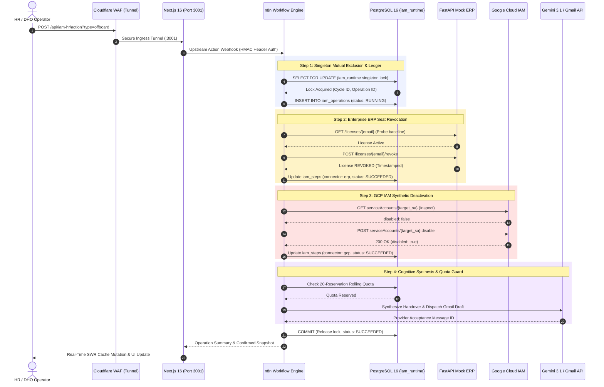

# IAM-HR Enterprise Offboarding Platform · PH3 Digital Factory

<p align="center">
  
  
  
  
  
  
  
  
</p>

---

## 📑 Table of Contents

- [Executive Summary](#-executive-summary)
- [Enterprise Architecture Blueprint](#-enterprise-architecture-blueprint)
- [System Sequence & Orchestration Flow](#-system-sequence--orchestration-flow)
- [Deep Dive: Transactional Idempotency & Mathematical Proof](#-deep-dive-transactional-idempotency--mathematical-proof)
- [DevSecOps Quality Gate & Pipeline Verification](#-devsecops-quality-gate--pipeline-verification)
- [Architecture Decision Records (ADR Suite)](#-architecture-decision-records-adr-suite)
- [Local Development & Verification](#-local-development--verification)
- [Production Runbook & Infrastructure](#-production-runbook--infrastructure)
- [Professional Vision & Engineering Creed](#-professional-vision--engineering-creed)

---

## 🏛 Executive Summary

The **IAM-HR Enterprise Offboarding Platform** solves one of the most critical vulnerabilities in corporate cybersecurity: **delayed, uncoordinated, and error-prone employee offboarding**.

In traditional corporate environments, revoking identity privileges across disparate systems (legacy on-prem ERPs, Google Cloud Platform, SaaS productivity suites) takes up to **48 hours of manual coordination**. This latency creates a critical attack surface:
- **Dormant Credentials & Orphan Accounts**: Departing employees retain active cloud access, violating **LGPD (Art. 46)** and **SOC 2 Type II (CC6.1 - Logical Access)** controls.
- **License Bloat**: Inactive SaaS and ERP seats continue billing unmonitored.
- **Inconsistent Revocation States**: Transient network failures during offboarding leave accounts partially deactivated with zero recovery visibility.

This platform implements an automated, deterministic offboarding orchestration engine backed by **PostgreSQL 16 relational ledgers**, **n8n deterministic pipelines**, **GCP IAM least-privilege synthetic identities**, and **Gemini 3.1 Flash Lite cognitive synthesis**.

```text
    ┌────────────────┐       Deterministic       ┌────────────────────────┐
    │  HR Operator   │ ────────────────────────> │ Zero-Trust IAM Engine  │
    │  Web Console   │   HTTPS / WAF Rate Limit  │ (Postgres / ERP / GCP) │
    └────────────────┘                           └────────────────────────┘
                                                              │
                                                     Idempotent Resumption
                                                     $f(f(x)) = f(x)$
                                                              ▼
                                                 ┌────────────────────────┐
                                                 │ Audit Ledger & Handover│
                                                 │ (Cloud Audit / Gemini) │
                                                 └────────────────────────┘
```

> [!IMPORTANT]
> **Demonstration Boundary**: This platform is a fully functional enterprise sandbox running on bare-metal infrastructure (`Cortex-01`) targeting seven allowlisted synthetic GCP Service Accounts. It demonstrates real distributed systems patterns, transactional idempotency, and defense-in-depth security.

---

## 📐 Enterprise Architecture Blueprint

The platform combines perimeter security, bare-metal container isolation, and least-privilege cloud integration:


### Key Architectural Layers

1. **Edge Perimeter & Ingress**: Cloudflare Zero Trust Tunnel exposes port `3001` with active WAF rate-limiting (**5 requests / 10s**) to mitigate automated enumeration, brute-force, and DDoS vectors.
2. **Compute Node (Cortex-01)**: Bare-metal host (Debian 12) running Docker on the isolated bridge network `factory_default`. Hosts the Next.js 16 frontend, n8n orchestration engine, PostgreSQL 16 ledger, and FastAPI Mock ERP.
3. **Google Cloud Platform (GCP Sandbox)**: Centralized IAM administrator service account (`iam-connector-admin`) governed by the custom least-privilege role `iamHrSyntheticLifecycle`, restricting operations strictly to `get`, `disable`, and `enable` over seven pre-seeded synthetic identities (`iamhr-*`).
4. **Cognitive Handover Delivery**: Gemini 3.1 Flash Lite synthesizes human-readable offboarding summaries delivered via Gmail OAuth2 API under a persistent database reservation quota.

---

## 🔄 System Sequence & Orchestration Flow



---

## ⚡ Deep Dive: Transactional Idempotency & Mathematical Proof

In distributed systems, operations across heterogeneous external networks cannot assume absolute transport reliability. Network timeouts, network partitions, and worker restarts frequently cause retries.

The platform guarantees mathematical idempotency across all side-effecting operations:

$$\forall x \in \text{Operations}: \quad f(f(x)) = f(x)$$

### The Idempotency State Machine

```text
                     ┌──────────────────┐
                     │     PENDING      │
                     └────────┬─────────┘
                              │ Acquire Singleton Lock
                              ▼
                     ┌──────────────────┐
          ┌───────── │     RUNNING      │ ─────────┐
          │          └────────┬─────────┘          │
          │                   │                    │
Connector │       All Steps   │   Downstream       │ Unrecoverable
Failure   │       Succeeded   │   Timeout          │ Fault
          ▼                   ▼                    ▼
   ┌─────────────┐     ┌─────────────┐      ┌─────────────┐
   │   PARTIAL   │     │  SUCCEEDED  │      │   FAILED    │
   └──────┬──────┘     └─────────────┘      └─────────────┘
          │                   ▲
          │ Selective Resume  │
          └───────────────────┘
```

### Empirical Proof: Production Operations 149 and 158

1. **Operation 149 (Initial State Transition & Execution)**:
   - Initiated offboarding for synthetic employee identity `iamhr-dana-scully@ph3digital.com.br`.
   - **Step 1 (Postgres)**: Updated internal employee status to `INACTIVE`.
   - **Step 2 (ERP)**: Revoked ERP software seat via `POST /licenses/{email}/revoke`.
   - **Step 3 (GCP IAM)**: Network interruption before connector confirmation; GCP account successfully disabled at provider level, but local step recorded state as `UNKNOWN`.
   - **System Defense**: The platform did not blindly mark failure nor did it allow uncoordinated repeats. The singleton lock preserved the operation in `PARTIAL` recovery status.

2. **Operation 158 (Selective Resumption Proof)**:
   - Resumed operation 158 within the same demonstration cycle using `POST /api/iam-hr/action?operation_id=158`.
   - **Postgres Check**: Already committed; write step **bypassed** ($0$ SQL writes).
   - **ERP Check**: Queried `GET /licenses/{email}`; returned status `REVOKED`; write step **bypassed** ($0$ ERP writes).
   - **GCP Check**: Queried `GET serviceAccounts/{email}`; confirmed `disabled: true`; write step **bypassed** ($0$ GCP writes).
   - **Result**: The system transitioned the overall operation to `SUCCEEDED` in **sub-second latency without generating duplicate writes or phantom audit entries**.

---

## 🛡 DevSecOps Quality Gate & Pipeline Verification

Every commit and pull request is audited through a deterministic multi-stage GitHub Actions pipeline (`.github/workflows/quality-gate.yml`):

| Engineering Domain | Verification Scope | Tooling & Strategy | Status |
|---|---|---|---|
| **DevSecOps** | Secret Detection & Git Sanity | Gitleaks v2, Whitespace Check | **PASS** |
| **Data Engineering** | Migration Integrity & Schema Safety | Schema verification (`002` & `003` additive SQL) | **PASS** |
| **Software Engineering** | API Contracts & Type Safety | 26 Contract Test Groups (Next.js 16 / TypeScript 5) | **PASS** |
| **SRE & Distributed Systems** | Idempotency Engine & Ledger Recovery | PGlite in-memory concurrency & selective resume | **PASS** |
| **FinOps** | Handover Quota & Token Abuse Control | 20-Reservation Rolling Window Enforcement | **PASS** |

To execute the quality suite locally:
```bash
# Run isolated in-memory ledger recovery suite
npm --prefix tests install
npm --prefix tests test

# Run API contract validation suite
npm --prefix tests run test:contracts

# Run handover rate-limiting suite
npm --prefix tests run test:handover
```

---

## 📂 Architecture Decision Records (ADR Suite)

All architectural inflection points are documented following the MADR (Markdown Architecture Decision Records) standard:

- [ADR 0001: Least-Privilege GCP IAM Synthetic Identities](./docs/adr/0001-least-privilege-gcp-iam-synthetic-identities.md) — Custom scoped role `iamHrSyntheticLifecycle20261009` and 7 allowlisted Service Accounts.
- [ADR 0002: Relational Ledger & Idempotent Resumption over Sheets](./docs/adr/0002-relational-ledger-and-idempotency-over-sheets.md) — PostgreSQL 16 singleton locking, state machines, and atomic handover reservations.
- [ADR 0003: Unified FastAPI ERP Simulator](./docs/adr/0003-unified-fastapi-erp-simulator.md) — Lightweight Python microservice simulating legacy on-premises license revocation.
- [ADR 0004: Bare-Metal Cortex-01 Hosting & Cloudflare WAF Bot Mitigation](./docs/adr/0004-bare-metal-cortex01-containerization-and-bot-mitigation.md) — Colocated Docker containerization eliminating HTTP 403 Bot Fight Mode false-positives.

---

## 💻 Local Development & Verification

### Prerequisites
- Node.js `20.x` or `24.x`
- Python `3.11+`
- Docker & Docker Compose (optional for isolated full-stack testing)

### Setup & Execution
```bash
# Clone the repository
git clone https://github.com/PhilipeOliveiraS/iam-hr-offboarding-platform.git
cd iam-hr-offboarding-platform

# Install root dependencies
npm ci

# Launch Next.js local development server
npm run dev
# Dashboard accessible at http://localhost:3000
```

### Environment Variables
Refer to `.env.example` for required configuration:
- `N8N_GET_DATA_URL`: Webhook URL for Workflow 01 (Dashboard metrics).
- `N8N_OFFBOARD_URL`: Webhook URL for Workflow 02 (Offboarding execution).
- `N8N_WEBHOOK_KEY`: HMAC secret passed in `X-N8N-Webhook-Secret` header.
- `N8N_REPORT_URL`: Webhook URL for Workflow 04 (Cognitive handover report).

---

## 🚀 Production Runbook & Infrastructure

The platform is deployed to the bare-metal homelab node `Cortex-01`:
- **Operating System**: Debian 12 (Bookworm)
- **Container Network**: `factory_default` (Docker bridge, unexposed internal ports)
- **Host Port Binding**: `127.0.0.1:3001:3000`
- **Reverse Proxy / Edge**: Cloudflare Zero Trust Tunnel with origin ingress to `127.0.0.1:3001`
- **Operational Procedures**: Detailed zero-downtime deployment, backup, and rollback runbooks are documented in [DEPLOY-CORTEX.md](DEPLOY-CORTEX.md).

---

## ✝ Professional Vision & Engineering Creed

> *"Whatever you do, work at it with all your heart, as working for the Lord, not for human masters."* — Colossians 3:23

With over **20 years of hands-on experience in mission-critical infrastructure, cloud architecture, and engineering leadership**, my professional mission is to design and build software systems that embody:
- **Absolute Integrity**: Software that behaves deterministically under failure, preserves truth in its audit trails, and protects user data with uncompromising zero-trust principles.
- **Architectural Discipline**: Resisting transient hype in favor of proven patterns—preferring idempotent relational ledgers, least-privilege identity boundaries, and self-healing systems.
- **Excellence to God's Glory**: Treating engineering craftsmanship as a calling of stewardship, diligence, and service.

**Philipe Oliveira**  
*Principal Enterprise Architect & DevSecOps Engineer*  
[PH3 Digital Factory](https://ph3digital.com.br/)
