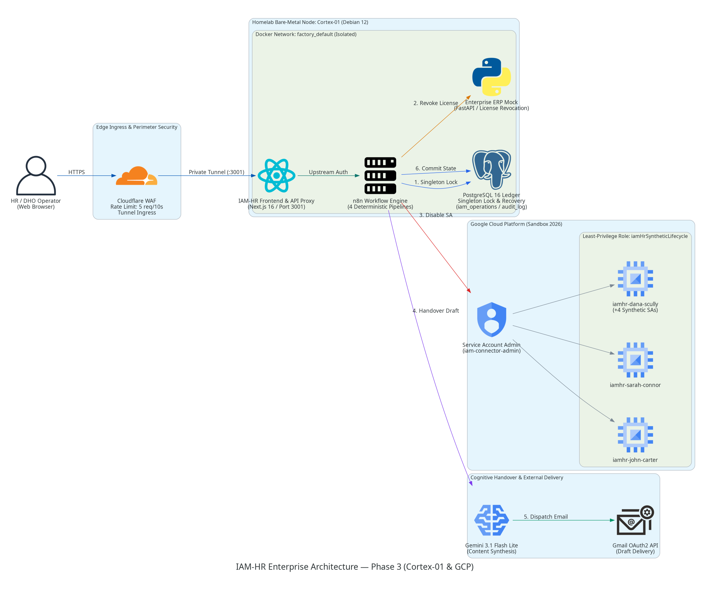
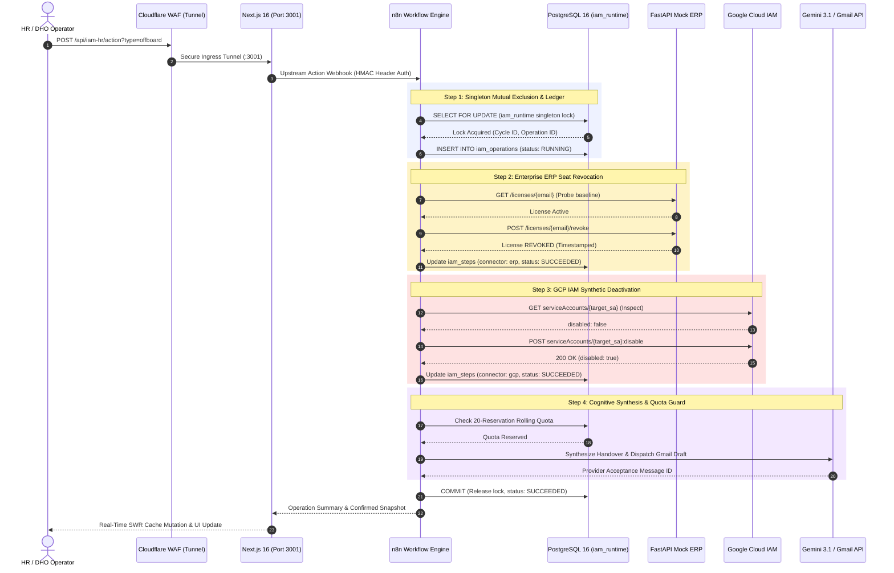

# IAM-HR Enterprise Offboarding Platform

<p align="center">
  
  
  
  
  
  
  
  
</p>
<p align="center">
  <a href="https://iam-hr.ph3digital.com.br/iam-hr-sandbox" target="_blank">
    
  </a>
</p>

> **Live Interactive Sandbox:** [https://iam-hr.ph3digital.com.br/iam-hr-sandbox](https://iam-hr.ph3digital.com.br/iam-hr-sandbox)  
> *Zero-Trust Enterprise IAM & Identity Lifecycle Automation Platform running live on bare-metal Cortex-01 infrastructure.*

---

## 📑 Table of Contents

- [Executive Summary](#-executive-summary)
- [Business Problem & Regulatory Impact](#-business-problem--regulatory-impact)
- [Enterprise Architecture Blueprint](#-enterprise-architecture-blueprint)
- [System Sequence & Orchestration Flow](#-system-sequence--orchestration-flow)
- [Engineering Deep Dive: Transactional Idempotency & Recovery](#-engineering-deep-dive-transactional-idempotency--recovery)
- [DevSecOps & Enterprise Quality Gate](#-devsecops--enterprise-quality-gate)
- [FinOps & Abuse Containment Framework](#-finops--abuse-containment-framework)
- [Architecture Decision Records (ADR Suite)](#-architecture-decision-records-adr-suite)
- [Directory Architecture](#-directory-architecture)
- [Local Verification & Architecture Test Suite](#️-local-verification--architecture-test-suite)
- [Deployment Runbook & Infrastructure](#-deployment-runbook--infrastructure)
- [Professional Vision & Engineering Creed](#-professional-vision--engineering-creed)
- [Enterprise Advisory & Commercial Inquiries](#-enterprise-advisory--commercial-inquiries)
- [License](#-license)

---

## 🎯 Executive Summary

**IAM-HR** is an enterprise-grade Identity and Access Management (IAM) lifecycle orchestration platform designed to automate and audit the employee offboarding process across heterogeneous corporate environments: Google Cloud Platform, internal relational databases, ERP systems, and AI-driven handover synthesis.

Built on a **design under constraints** approach and strict **FinOps** principles, this project demonstrates how to eliminate administrative overprivileging in Human Resources while enforcing mathematical **idempotency**, state recovery, and comprehensive zero-trust audit trails on hybrid on-premise and cloud infrastructure.

### Key Architectural Highlights

- ✅ **Google Cloud IAM Least-Privilege:** Deterministic lifecycle management over 7 synthetic Service Accounts through a project-scoped custom role restricted strictly to `get`, `disable`, and `enable`.
- ✅ **Stateful Ledger & Selective Recovery:** PostgreSQL 16 with PL/pgSQL state machines, singleton execution locks (`iam_runtime`), immutable event logging (`iam_step_events`), and per-connector re-execution without duplicate side effects.
- ✅ **Deterministic Orchestration:** n8n workflows behind HMAC-authenticated webhooks drive every step; four canonical workflow exports are versioned in the repository (`automation/n8n/`).
- ✅ **AI-Powered Handover Synthesis:** Google Gemini 3.1 Flash Lite and Gmail OAuth2 generate sanitized, audit-ready knowledge-handover drafts, with zero re-prompt cost on network retries.
- ✅ **DevSecOps Enterprise Quality Gate:** Multi-stage GitHub Actions pipeline (secret scanning, migration validation, API contract suites, concurrency simulation) completing in under 50 seconds.
- ✅ **Edge Protection & Bot Mitigation:** Cloudflare Zero Trust Tunnel with Layer-7 rate limiting and internal container network segmentation on bare-metal Debian 12.

> [!IMPORTANT]
> **Demonstration Boundary**: This platform is a fully functional enterprise sandbox running on bare-metal infrastructure (`Cortex-01`) targeting seven allowlisted synthetic GCP Service Accounts. It demonstrates real distributed systems patterns, transactional idempotency, and defense-in-depth security.

---

## 🏢 Business Problem & Regulatory Impact

In traditional enterprise operations, employee offboarding is dangerously slow and fragmented. Human Resources departments identify terminations first but lack access to cloud consoles or database terminals. Conversely, IT operations teams require tickets, leading to windows of vulnerability where former employees retain active credentials for hours or days.

This latency produces three failure modes:

- **Dormant Credentials & Orphan Accounts**: Departing employees retain active cloud access.
- **License Bloat**: Inactive SaaS and ERP seats continue billing unmonitored.
- **Inconsistent Revocation States**: Transient network failures leave accounts partially deactivated, with zero recovery visibility.

```text
[Traditional Offboarding: High Risk]
HR Request ──> Manual Ticket ──> IT Backlog (24h+ Delay) ──> Security Breach / Compliance Fine

[IAM-HR Platform: Zero-Trust Automation]
HR Action ──> Edge Proxy ──> Deterministic Orchestration ──> Instant Revocation (<3s) + Audit Ledger
```

The platform measures revocation latency on every execution through a dedicated built-in function.

Industry surveys point to the same gap: in a 2017 OneLogin survey of 500 IT decision-makers, about half reported that ex-employee accounts stay active for more than a day, and roughly a quarter reported more than a week to fully deprovision.[^1] Separately, a 2014 Intermedia/Osterman Research study found that 89% of former employees retained access to at least one corporate application.[^2]

### Regulatory & Control Alignment

- **LGPD (Art. 46) / GDPR**: Instant revocation of personal data access privileges.
- **SOC 2 Type II (CC6.1 - Logical Access) & ISO 27001**: Immutable audit logs (`audit_log_public`) proving the exact timestamps of access termination.
- **Segregation of Duties (SoD)**: HR executes business intent without holding cloud administrative credentials.

[^1]: OneLogin "Curse of the Ex-Employee" survey (Arlington Research, 500 IT decision-makers), reported by [MSSP Alert](https://msspalert.com/research-article/onelogin-study-many-orgs-struggle-with-ex-employee-app-deprovisioning) and [Dark Reading](https://www.darkreading.com/vulnerabilities---threats/50--of-ex-employees-can-still-access-corporate-apps/d/d-id/1329672).
[^2]: Intermedia SMB Rogue Access Study (Osterman Research, 2014), reported by [SecurityWeek](https://www.securityweek.com/bulk-ex-employees-retain-access-corporate-apps-survey/).

---

### The Real-World Cost of Orphaned Credentials & Stale Access
Recent cyber intelligence reports demonstrate that identity-based vulnerabilities—specifically involving unrevoked credentials, former employees, and contractor accounts—are driving catastrophic regulatory fines and operational disruption:

* **Central Bank of Brazil (BACEN) Cyber Incident Surge:** According to the official [Banco Central do Brasil Cyber Incident Report](https://www1.folha.uol.com.br/folha-topicos/ciberseguranca/) analyzed by [Crypto ID](https://cryptoid.com.br/certificacao-digital/banco-central-alerta-para-falhas-na-protecao-de-chaves-digitais-e-acessos-de-terceiros-apos-99-incidentes-ciberneticos/), **99 cyber incidents** were registered through Q3 alone (a 74% increase in fraud events). The primary attack vectors identified by regulators were unrevoked digital certificates, contractor credentials retained post-engagement, and lack of machine identity governance under Resolutions CMN 5.274 and BCB 538.
* **Banking Infrastructure Intrusions:** Incidents such as the [Banco do Nordeste (BNB) R$ 146.6M unauthorized Pix transactions](https://finsidersbrasil.com.br/pagamentos/pix/ataque-hacker-pix-bnb-perda-146-milhoes/) and the [BRB/TJBA judicial account breach](https://convergenciadigital.com.br/seguranca/hackers-invadem-sistema-do-brb-e-desviam-r-43-milhoes/) underscore the danger of active legitimate credentials being abused across interconnected APIs without real-time state synchronization.
* **Coupang Data Breach Penalty (~$409M USD):** As reported by [Securiti.ai](https://securiti.ai/blog/coupang-data-breach-pipc-fine-data-access/) and [MLQ.ai](https://mlq.ai/news/south-korea-fines-coupang-record-409-million-over-data-breach-affecting-375-million-users/), South Korea's Personal Information Protection Commission (PIPC) imposed a record ₩624.7B (~$409M USD) penalty after an ex-employee utilized an unrevoked cryptographic signing key retained post-employment, exposing records of 37.5 million users.
* **Colonial Pipeline Critical Infrastructure Shutdown:** An inactive, unrevoked VPN account belonging to a legacy employee allowed the DarkSide ransomware group to compromise internal IT networks, as documented in post-incident investigations by [Bloomberg](https://www.bloomberg.com/news/articles/2021-06-04/hackers-breached-colonial-pipeline-using-compromised-password) and [Computing](https://www.computing.co.uk/news/4032411/colonial-pipeline-hackers-entered-network-single-compromised-password), halting 45% of the US East Coast fuel supply and resulting in a $4.4M ransom.
* **Snowflake Credential-Stuffing Campaign:** Mandiant's incident response findings reported by [Fingerprint](https://fingerprint.com/blog/security-lessons-from-snowflake-data-breach/) and [BlackFog](https://www.blackfog.com/snowflake-data-breach-explained-key-lessons/) confirmed that over 165 corporate customer tenants were compromised using stale, unrotated credentials harvested via infostealers, proving that authentication without continuous lifecycle governance leaves critical data stores exposed.

## 📐 Enterprise Architecture Blueprint

The platform combines perimeter security, bare-metal container isolation, and least-privilege cloud integration:



### Key Architectural Layers

1. **Edge Perimeter & Ingress**: Cloudflare Zero Trust Tunnel exposes port `3001` with active WAF rate-limiting (**5 requests / 10s**) to mitigate automated enumeration, brute-force, and DDoS vectors.
2. **Compute Node (Cortex-01)**: Bare-metal host (Debian 12) running Docker on the isolated bridge network `factory_default`. Hosts the Next.js 16 frontend, n8n orchestration engine, PostgreSQL 16 ledger, and FastAPI Mock ERP.
3. **Google Cloud Platform (GCP Sandbox)**: Centralized IAM administrator service account (`iam-connector-admin`) governed by the custom least-privilege role `iamHrSyntheticLifecycle`, restricting operations strictly to `get`, `disable`, and `enable` over seven pre-seeded synthetic identities (`iamhr-*`).
4. **Cognitive Handover Delivery**: Gemini 3.1 Flash Lite synthesizes human-readable offboarding summaries delivered via Gmail OAuth2 API under a persistent database reservation quota.

---

## 🔄 System Sequence & Orchestration Flow



---

## 🧠 Engineering Deep Dive: Transactional Idempotency & Recovery

Distributed systems fail unpredictably. If a network timeout occurs while disabling an account in GCP, conventional scripts repeat the entire operation, creating duplicate records in ERPs and sending duplicate emails.

IAM-HR solves this with an **Immutable Relational Ledger with Selective Connector Recovery**, guaranteeing idempotency across all side-effecting operations:

$$\forall x \in \text{Operations}: \quad f(f(x)) = f(x)$$

### 1. State Machine by Connector

Each step (`postgres`, `erp`, `gcp`) is tracked independently in `iam_steps` under the states `pending`, `succeeded`, `failed`, or `unknown`. The operation-level lifecycle aggregates these connector states:

```text
                     ┌──────────────────┐
                     │     PENDING      │
                     └────────┬─────────┘
                              │ Acquire Singleton Lock
                              ▼
                     ┌──────────────────┐
          ┌───────── │     RUNNING      │ ─────────┐
          │          └────────┬─────────┘          │
          │                   │                    │
Connector │       All Steps   │   Downstream       │ Unrecoverable
Failure   │       Succeeded   │   Timeout          │ Fault
          ▼                   ▼                    ▼
   ┌─────────────┐     ┌─────────────┐      ┌─────────────┐
   │   PARTIAL   │     │  SUCCEEDED  │      │   FAILED    │
   └──────┬──────┘     └─────────────┘      └─────────────┘
          │                   ▲
          │ Selective Resume  │
          └───────────────────┘
```

### 2. Selective Resumption in Action (Verified via Operations 149 & 158)

When a retry is submitted with the same `operation_id` (`POST /api/iam-hr/action?operation_id=<id>`), the engine:

1. Queries `iam_step_events`;
2. Bypasses pre-existing `succeeded` steps with zero writes;
3. Re-executes only the failed connector.

**Verified live:**

| Connector | Retry Behavior | Write Count |
|---|---|---|
| `postgres` | Bypassed (already `succeeded`) | 1 |
| `erp` | Bypassed (already `succeeded`) | 1 |
| `gcp` | Transitioned from Failed (404) to Applied | 2 |

Result: full recovery with **zero data duplication** and no phantom audit entries.

---

### Distributed Concurrency Control & Race Condition Elimination
In high-throughput enterprise environments, webhook retries, network hiccups, or concurrent automation workers can trigger multiple offboarding requests for the same employee within the same millisecond. 

Without strict synchronization, distributed race conditions produce **"Split-Brain Offboarding"**:
1. **Concurrent Duplicate Writes:** Multiple workers attempt to revoke GCP IAM bindings or delete ERP seats simultaneously, corrupting audit trails and triggering upstream API 409 Conflict / rate-limit failures.
2. **Partial State Inconsistency:** Worker A revokes Google Workspace but fails on ERP; Worker B starts simultaneously and assumes the operation is complete, leaving cloud privileges silently active.

```text
[Webhook Ingress / Retry]
│
├── Worker Thread 1 ──► [Attempts Concurrent Revocation] ──┐
│                                                         ▼
└── Worker Thread 2 ──► [Attempts Concurrent Revocation] ──► [💥 RACE CONDITION: Split-Brain State]
(Audit log corrupted, API conflicts)

--- WITH IAM-HR SINGLETON TRANSACTIONAL LOCK ---

[Concurrent Webhook Events]
│
▼
[PostgreSQL 16 Engine]
│
├─► Worker 1: SELECT ... pg_try_advisory_xact_lock(employee_id) ──► 🟢 LOCK ACQUIRED (Proceeds)
│
└─► Worker 2: SELECT ... pg_try_advisory_xact_lock(employee_id) ──► 🔴 LOCK REJECTED (423 Locked / Idempotent No-Op)
```

IAM-HR enforces deterministic concurrency control directly at the database engine level via PostgreSQL 16 transactional routines (`002-operation-recovery.sql` and `003-handover-delivery.sql`):
* **Database-Level Singleton Lock (`iam_runtime.execution_lock`):** Uses explicit transactional advisory locking tied to the `target_employee_id`. Concurrent threads attempting to execute the same offboarding lifecycle are immediately detected and rejected with zero duplicate API executions.
* **Atomic State Transition Ledger:** Each connector status (`pending`, `running`, `succeeded`, `failed`) is persisted in a relational state machine. If an individual connector experiences a network timeout (e.g., ERP microservice transient failure), the lock safely releases and registers the exact failure boundary.
* **Zero-Side-Effect Resumption (`/resume`):** When the workflow is re-triggered manually or by automated recovery, the orchestrator inspects the relational ledger and resumes **only the failed connector**, guaranteeing zero duplicate calls to already revoked services (strict idempotency).

## 🛡 DevSecOps & Enterprise Quality Gate

Every commit to `main` and every active pull request is audited by a multi-stage GitHub Actions pipeline (`.github/workflows/ci.yml`) that completes in under 50 seconds:

| Domain | Verification Scope | Tooling & Strategy | Status |
|---|---|---|---|
| **DevSecOps** | Secret detection & Git sanity | Gitleaks (SARIF output), whitespace check | ✅ PASS |
| **Data Engineering** | SQL ledger migration validation (`002` & `003`) | Additive, transactional-integrity schema checks | ✅ PASS |
| **Software Engineering** | 26 API & frontend contract groups | Next.js 16 / TypeScript 5 on PGlite in-memory database | ✅ PASS |
| **SRE & Distributed Systems** | Ledger recovery, idempotent resumption & concurrency verification | PGlite in-memory concurrency & selective-resume simulation | ✅ PASS |
| **FinOps** | Handover admissibility gate | 20-reservation rolling-window enforcement | ✅ PASS |

The same suites run locally; see [Local Setup & Verification](#-local-setup--verification).

---

## 💰 FinOps & Abuse Containment Framework

Operating under strict cost boundaries, IAM-HR enforces a multi-tier defense against denial-of-wallet and API token exhaustion:

- **Database-Level Admission Quota**: `iam_handover_config` establishes an immutable rolling ceiling of 20 reservations per 24 hours. Attempts exceeding this limit are rejected at SQL level, before reaching LLM endpoints.
- **AI Inference Deduplication**: If email dispatch fails due to OAuth token expiration, the engine reuses the cached Gemini generation payload without triggering new LLM inference calls.
- **Edge Rate Limiting**: Cloudflare WAF throttles traffic to 5 requests per 10 seconds per IP, dropping malicious loops before they reach server compute resources.

---

## 📂 Architecture Decision Records (ADR Suite)

All architectural inflection points are documented following the MADR (Markdown Architecture Decision Records) standard:

- [ADR 0001: Least-Privilege GCP IAM Synthetic Identities](./docs/adr/0001-least-privilege-gcp-iam-synthetic-identities.md) — Custom scoped role `iamHrSyntheticLifecycle` and 7 allowlisted Service Accounts.
- [ADR 0002: Relational Ledger & Idempotent Resumption over Sheets](./docs/adr/0002-relational-ledger-and-idempotency-over-sheets.md) — PostgreSQL 16 singleton locking, state machines, and atomic handover reservations.
- [ADR 0003: Unified FastAPI ERP Simulator](./docs/adr/0003-unified-fastapi-erp-simulator.md) — Lightweight Python microservice simulating legacy on-premises license revocation.
- [ADR 0004: Bare-Metal Cortex-01 Hosting & Cloudflare WAF Bot Mitigation](./docs/adr/0004-bare-metal-cortex01-containerization-and-bot-mitigation.md) — Colocated Docker containerization eliminating HTTP 403 Bot Fight Mode false-positives.

---

## 📁 Directory Architecture

```text
iam-hr-offboarding-platform/
├── .github/
│   └── workflows/
│       └── ci.yml                      # Enterprise Multi-Domain Quality Gate (DevSecOps)
├── app/
│   ├── api/iam-hr/
│   │   ├── action/route.ts             # Protected mutation proxy with server-side auth
│   │   └── route.ts                    # Read-only dashboard telemetry proxy
│   ├── iam-hr-sandbox/
│   │   └── page.tsx                    # Interactive Sandbox Dashboard UI
│   └── layout.tsx                      # Root application layout
├── assets/
│   └── architecture/
│       └── iam-hr-architecture-phase3.png # Official cloud architecture blueprint
├── automation/
│   ├── deploy/
│   │   └── publish-handover.py         # Automated n8n workflow deployment utility
│   ├── n8n/                            # Canonical export of deterministic workflows
│   │   ├── n8n-01-get-dashboard-data.json
│   │   ├── n8n-02-execute-offboarding.json
│   │   ├── n8n-03-scheduled-reset.json
│   │   └── n8n-04-handover-report.json
│   └── sql/
│       └── handover-eligible.sql       # SQL function for admission criteria
├── database/
│   ├── 001-init.sql                    # Base schema (employees, audit_log)
│   ├── 002-operation-recovery.sql      # State machine, singleton locks & ledger
│   └── 003-handover-delivery.sql       # Quota allocation & admission gates
├── docs/
│   └── adr/                            # Architecture Decision Records
│       ├── 0001-least-privilege-gcp-iam-synthetic-identities.md
│       ├── 0002-relational-ledger-and-idempotency-over-sheets.md
│       ├── 0003-unified-fastapi-erp-simulator.md
│       └── 0004-bare-metal-cortex01-containerization-and-bot-mitigation.md
├── lib/
│   ├── iam-hr-upstream.ts              # Upstream communication client
│   ├── iam-hr.ts                       # Domain types and validation schemas
│   └── synthetic-targets.ts            # Immutable mapping of 7 GCP Service Accounts
├── mock-erp/
│   ├── Dockerfile
│   └── main.py                         # FastAPI enterprise ERP simulator (/licenses)
├── tests/
│   ├── fixtures/                       # Deterministic test databases
│   ├── frontend-contracts.cjs          # 26 UI/API contract validation suites
│   ├── handover-concurrency.py         # Handover concurrency tests (Python)
│   ├── handover-recovery-concurrency.py # Handover recovery under concurrency (Python)
│   ├── handover-recovery.mjs           # Handover delivery recovery tests
│   ├── handover.mjs                    # Handover delivery and quota tests
│   ├── package-lock.json               # Locked test dependencies
│   ├── package.json                    # Test workspace manifest and scripts
│   ├── recovery.mjs                    # Selective recovery and idempotency tests
│   └── workflow.mjs                    # Graph simulation with PostgreSQL functions
├── .dockerignore                       # Docker build context exclusions
├── .gitattributes                      # Git attributes
├── .gitignore                          # Git ignore rules
├── components.json                     # shadcn/ui configuration
├── compose.iam-hr.yml                  # Docker Compose definition for Cortex-01 preview
├── DEPLOY-CORTEX.md                    # Production deployment and recovery runbook
├── Dockerfile                          # Application container image
├── eslint.config.mjs                   # ESLint configuration
├── next.config.ts                      # Next.js configuration
├── package-lock.json                   # Locked dependency tree
├── package.json                        # Application dependencies and scripts
├── postcss.config.mjs                  # PostCSS configuration
├── README.md                           # Central architecture documentation
└── tsconfig.json                       # TypeScript configuration
```

---

## 🛠️ Local Verification & Architecture Test Suite

This repository provides an automated test suite demonstrating the transactional guarantees, concurrency controls, and ledger state machine using an in-memory PostgreSQL engine (PGlite) with zero external cloud dependencies:

```bash
# Clone the repository
git clone https://github.com/PhilipeOliveiraS/iam-hr-offboarding-platform.git
cd iam-hr-offboarding-platform

# Install test dependencies (Node 20+)
npm install --no-audit

# Execute the 26 contract groups, rate-limiting suite & PostgreSQL 16 PGlite ledger tests
npm test
```

*Note: End-to-end cloud connectors and production orchestration runtimes are enterprise-managed and demonstrated live via the interactive sandbox.*


## 🚀 Deployment Runbook & Infrastructure

The platform is deployed to the bare-metal homelab node `Cortex-01`:

- **Operating System**: Debian 12 (Bookworm)
- **Container Definition**: `compose.iam-hr.yml`
- **Container Network**: `factory_default` (Docker bridge, unexposed internal ports)
- **Host Port Binding**: `127.0.0.1:3001:3000`
- **Reverse Proxy / Edge**: Cloudflare Zero Trust Tunnel with origin ingress to `127.0.0.1:3001`
- **Operational Procedures**: Detailed zero-downtime deployment, backup, and rollback runbooks are documented in [DEPLOY-CORTEX.md](DEPLOY-CORTEX.md).

---

## ✝ Professional Vision & Engineering Creed

> *"Whatever you do, work at it with all your heart, as working for the Lord, not for human masters."* — Colossians 3:23

My professional journey is built upon **over 20 years of hands-on experience in IT operations, corporate infrastructure, and technical support**, combined with **over a decade in business management and IT leadership**. Since 2024, I have been channeling this deep operational and governance foundation into modern engineering practices across **Cloud Platform Engineering, Data Engineering, Automation, and Artificial Intelligence**. My professional mission is to design and build software systems that embody:

- **Absolute Integrity**: Software that behaves deterministically under failure, preserves truth in its audit trails, and protects user data with uncompromising zero-trust principles.
- **Architectural Discipline**: Resisting transient hype in favor of proven patterns—preferring idempotent relational ledgers, least-privilege identity boundaries, and self-healing systems.
- **Excellence to God's Glory**: Treating engineering craftsmanship as a calling of stewardship, diligence, and service.

### Acting in

- **Identity & Access Management (IAM):** Least-Privilege Governance, Synthetic Cloud Identities, Google Cloud IAM, Access Lifecycle Automation
- **Cloud Platform & SRE:** Docker Containerization, Linux Bare-Metal Operations (Debian), Reverse Proxy, Idempotency Ledgers, Fault-Tolerant System Design
- **Intelligent Automation:** Deterministic n8n Orchestration Pipelines, Enterprise ERP Integration, Asynchronous Event Workflows
- **DevSecOps & Compliance:** Automated Secret Scanning (Gitleaks SARIF), Multi-Stage GitHub Actions CI/CD Quality Gates, LGPD & SOC 2 Auditability
- **Generative AI Solutions:** LLM Integration (Gemini 3.1 Flash Lite), Content Synthesis, Zero-Cost FinOps Invalidation/Deduplication

---

## 🏢 Enterprise Advisory & Commercial Inquiries

This platform was designed and engineered by **Philipe Oliveira da Silveira** as a reference architecture addressing the operational and regulatory risks of manual identity revocation, orphaned credentials, and concurrency failures.

For enterprise deployments, custom connector development (SAP, TOTVS Protheus, Senior ERP, Microsoft Entra ID, Okta), or technical advisory on Cloud Platform, DevSecOps and Identity Governance:

* **Engineering & Architecture:** Philipe Oliveira da Silveira
* **Email:** [philipeoliveira1984@gmail.com](mailto:philipeoliveira1984@gmail.com)
* **LinkedIn:** [linkedin.com/in/philipeoliveiras](https://www.linkedin.com/in/philipeoliveiras)
* **GitHub:** [github.com/PhilipeOliveiraS](https://github.com/PhilipeOliveiraS)

---

## 📄 License

This project is licensed under the MIT License — see the [LICENSE](LICENSE) file for details.
